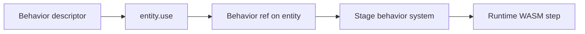

Behaviors attach reusable simulation and gameplay logic to entities through `entity.use(...)`. Import descriptors from `@zylem/game-lib/behavior`; each descriptor wires a stage-scoped system, optional runtime components on the entity, and an optional handle with behavior-specific methods. Use behaviors when movement, combat helpers, boundaries, or presentation hooks belong on the entity rather than in ad hoc `onUpdate` code.

The stack is **game-lib → behaviors → runtime**: game-lib owns entities and the frame loop, `@zylem/behaviors` owns descriptors and simulation-facing components, and `@zylem/runtime` (WASM) executes physics and several high-level controllers. See [Architecture: Behaviors](/docs/architecture/behaviors) for how systems attach at spawn time.

## Minimal example

A complete sample lives in `website/snippets/behaviors/overview.ts`. The pattern is attach, then read the handle and write input each frame:

```typescript
import { createGame } from '@zylem/game-lib/core';
import { createSphere } from '@zylem/game-lib/entity';
import { WorldBoundary2DBehavior } from '@zylem/game-lib/behavior';

const ball = createSphere();
const boundary = ball.use(WorldBoundary2DBehavior, {
  boundaries: { top: 3, bottom: -3, left: -6, right: 6 },
});

ball.onUpdate(({ me, inputs, delta }) => {
  const { Horizontal, Vertical } = inputs.p1.axes;
  let moveX = Horizontal.value * 600 * delta;
  let moveY = -Vertical.value * 600 * delta;
  const clamped = boundary.getMovement(moveX, moveY);
  me.moveXY(clamped.moveX, clamped.moveY);
});

createGame(ball).start();
```

## How a behavior is put together



| Piece | Role |
| --- | --- |
| **Descriptor** | Created with `defineBehavior`; exposes `defaultOptions`, `systemFactory`, and optional `createHandle`. |
| **Handle** | Return value of `entity.use(...)`; base members are `getOptions()`, `getFSM()`, `enabled`, `enable()`, `disable()`, and `setOptions()`, plus behavior-specific APIs. |
| **Input components** | Prefixed with `$` on the entity (for example `$platformer2D`, `$thruster`); your game writes these from input each frame. |
| **Config / state components** | Unprefixed fields (for example `platformer2D`, `jumper2dState`) hold merged options and runtime state. |
| **FSM** | Optional; use when consumers need discrete modes (`Platformer2DState`, `ScreenWrapState`, …). Not every behavior needs one. |

## Toggling behaviors at runtime

An entity holds one of each behavior. The first `use()` creates the behavior and its handle; a later `use()` of the same descriptor returns that same handle. To stop a behavior during play, call `disable()` on its handle. To start it again, call `enable()`. Both take effect at once and neither builds new objects, so they are safe to call often: on a key press, on a timer, or for hundreds of entities in one frame.

`website/snippets/behaviors/toggling.ts` swaps two pairs of behaviors on one ship. Input swaps how it moves, and a timer swaps what happens at the edge of the play area:

```typescript
import { createGame } from '@zylem/game-lib/core';
import { createSprite } from '@zylem/game-lib/entity';
import { callFunc, delay, repeatForever, sequence } from '@zylem/game-lib/actions';
import {
	ScreenWrapBehavior,
	ThrusterBehavior,
	TopDownMovementBehavior,
	WorldBoundary2DBehavior,
} from '@zylem/game-lib/behavior';

const ship = createSprite({ name: 'ship' });

// Attach each behavior once and keep its handle.
const thruster = ship.use(ThrusterBehavior, { linearThrust: 10, angularThrust: 4 });
const topDown = ship.use(TopDownMovementBehavior, { moveSpeed: 8 });
const wrap = ship.use(ScreenWrapBehavior, { width: 24, height: 14 });
const boundary = ship.use(WorldBoundary2DBehavior, {
	boundaries: { left: -12, right: 12, bottom: -7, top: 7 },
});

// A behavior that should not run yet starts switched off.
topDown.disable();
boundary.disable();

// Input: swap how the ship moves.
ship.onUpdate(({ inputs }) => {
	if (!inputs.p1.buttons.A.pressed) return;
	if (thruster.enabled) {
		thruster.disable();
		topDown.enable();
	} else {
		topDown.disable();
		thruster.enable();
	}
});

// Timer: swap what happens at the edge every four seconds.
ship.runAction(
	repeatForever(
		sequence(
			delay(4000),
			callFunc(() => {
				if (wrap.enabled) {
					wrap.disable();
					boundary.enable();
				} else {
					boundary.disable();
					wrap.enable();
				}
			}),
		),
	),
);

// Change options later. A running behavior restarts with the merged options.
thruster.setOptions({ linearThrust: 16 });

createGame(ship).start();
```

| Call | What it does |
| --- | --- |
| `handle.enabled` | `true` while the behavior is switched on. |
| `handle.disable()` | Stop the behavior. Its options are kept. |
| `handle.enable()` | Start the behavior again from its initial state, with its current options. |
| `handle.setOptions(partial)` | Merge new option values into the existing ones. A running behavior restarts with them. |
| `entity.use(Descriptor, options?)` | The first call attaches the behavior. A repeat call merges `options`, enables the behavior, and returns the same handle. |
| `entity.unuse(Descriptor)` | Remove the behavior and its handle for good. Use it at a loading point, not as a pause. |
| `entity.hasBehavior(Descriptor)`, `entity.getBehaviorRefs()` | Report enabled behaviors only. |
| `entity.getBehaviorHandle(Descriptor)` | The handle for a behavior, enabled or not, or `null` when the entity does not have it. |

A behavior that is enabled again starts from scratch: its FSM returns to its first state and its input component is cleared. The body keeps the velocity it had. Options and the on/off state survive a stage reload, and `clone()` copies both.

Which behaviors can be toggled during play:

- `ThrusterBehavior`, `TopDownMovementBehavior`, `ScreenWrapBehavior`, `WorldBoundary2DBehavior`, `WorldBoundary3DBehavior`, `Ricochet2DBehavior`, and `Ricochet3DBehavior` are built for it. A toggle on any of them allocates nothing.
- Any other behavior whose system implements `detach` can be toggled too. See [Writing a behavior](/docs/behaviors/writing-a-behavior).
- `Platformer2DBehavior`, `Platformer3DBehavior`, `Jumper2DBehavior`, `Jumper3DBehavior`, `FirstPersonBehavior`, `Shooter2DBehavior`, `CooldownBehavior`, `Destructible3DBehavior`, and `ScreenVisibilityBehavior` cannot be stopped once their entity is spawned. On a spawned entity, `disable()`, `unuse()`, and `setOptions()` on a running one throw `not removable at runtime` and change nothing. They can still be disabled before the entity is spawned.

The showcase runs this example as the **Behavior Toggling** exhibit, in `showcase/src/demos/behavior-toggling/behavior-toggling.ts`.

## Catalog and related pages

- [Coordinators](/docs/behaviors/coordinators) — map one input snapshot into several behaviors.
- [Runtime 2D](/docs/behaviors/runtime-2d) — WASM-only attach markers for classic 2D arcade scenes.
- [Writing a behavior](/docs/behaviors/writing-a-behavior) — author a new descriptor.
- [Behavior catalog](/docs/behaviors/catalog/platformer) — movement, combat, boundaries, VFX, and utilities.

## Taxonomy

**Composable primitives** focus on one job: `CooldownBehavior`, `Shooter2DBehavior`, `WorldBoundary2DBehavior`, `Ricochet2DBehavior`, `ScreenWrapBehavior`, `ScreenVisibilityBehavior`, `TopDownMovementBehavior`, `ThrusterBehavior`, jump helpers (`Jumper2DBehavior`, `Jumper3DBehavior`), `ParticleEmitterBehavior`, `Destructible3DBehavior`, and similar.

**Higher-level controllers** bundle concerns: `Platformer2DBehavior`, `Platformer3DBehavior`, and `FirstPersonBehavior` combine movement, grounding, and camera presentation.

## Pitfalls

- Handles that depend on spawned state (FSM, last hits) return empty values until the entity is spawned and systems have run at least once.
- Prefer behavior handles and input components over duplicating physics math in `onUpdate`.
- WASM-backed behaviors (platformer, top-down, thruster, first-person) expect colliders and a live stage; kinematic helpers such as `WorldBoundary2DBehavior` can clamp manual `moveXY` without a dynamic body.
- An entity holds one of each behavior. A second `use()` with the same descriptor updates the first; it does not add another.
- A behavior creates its input component (`$thruster`, `$topDownMovement`, …) the first time it runs. If a behavior starts disabled, check that the component exists before writing to it.
- `ThrusterBehavior` and `TopDownMovementBehavior` drive the same body. Run one at a time.
- A handle stops working after `unuse()`: `enable()` and `setOptions()` throw. Call `use()` again for a new handle.
- Import from `@zylem/game-lib/behavior`, not the root `@zylem/game-lib` barrel.

## API reference

- [`entity.use`](/docs/api) and behavior exports on `@zylem/game-lib/behavior`
- [`entity.unuse`](/docs/api/entity/interfaces/GameEntity#unuse), [`entity.getBehaviorHandle`](/docs/api/entity/interfaces/GameEntity#getbehaviorhandle), [`entity.hasBehavior`](/docs/api/entity/interfaces/GameEntity#hasbehavior)
- [`defineBehavior`](/docs/api), [`useBehavior`](/docs/api)
- Generated reference: [API](/docs/api)
